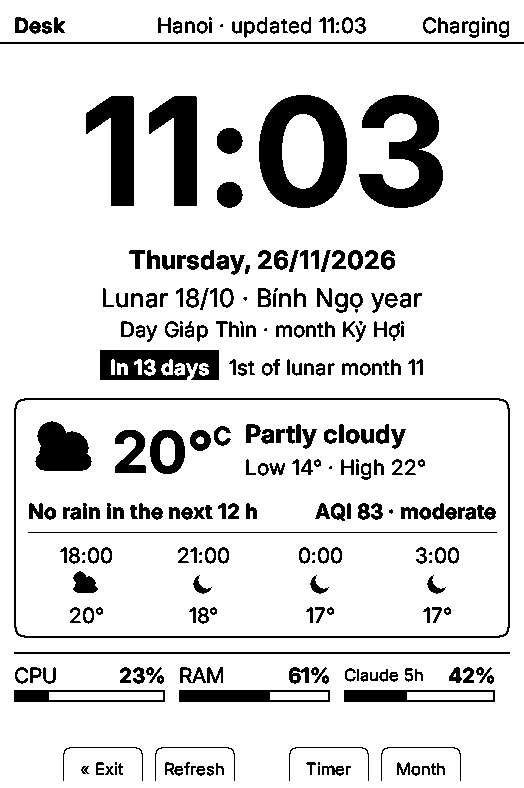
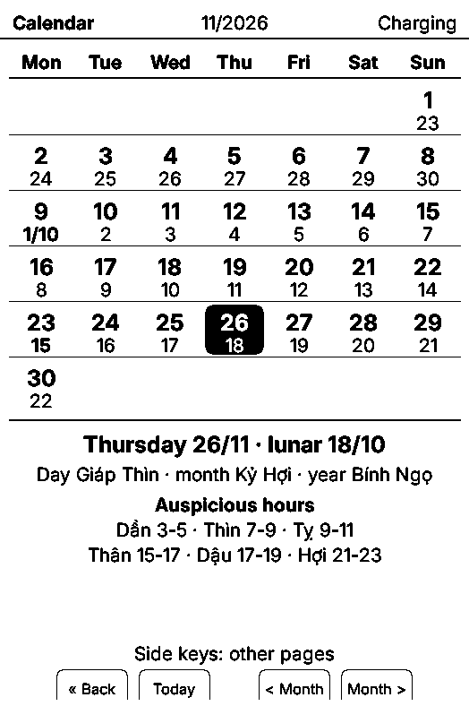
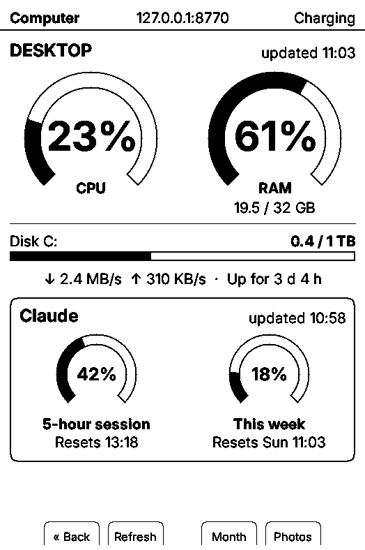
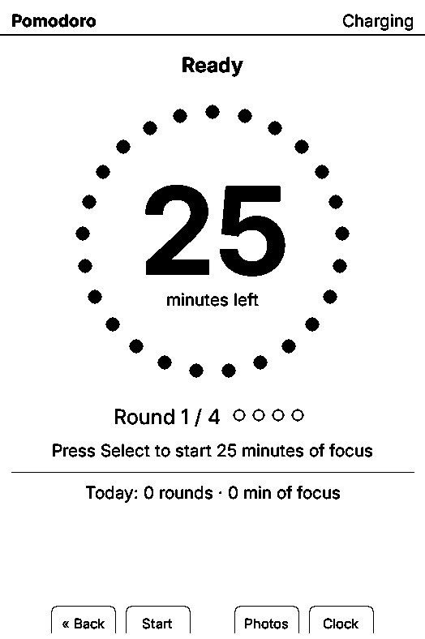

# Desk mode

Desk turns a reader that sits on your desk into a clock and dashboard: the time, the
Gregorian and Vietnamese lunar calendar, the weather, your PC's CPU, RAM and Claude usage,
a photo frame and a Pomodoro timer. It is in every firmware (X3/X4, X4 Pro, X4 Classic).

Open it from **Applications → Desk**. **Back** leaves Desk.

| Main | Month calendar |
| --- | --- |
|  |  |

| PC and Claude | Pomodoro |
| --- | --- |
|  |  |

## Pages

- **Main**: a large clock, the date, the lunar date with its day and month names, the next
  lunar milestone, a weather card (now, low and high, rain in the next 12 hours, air quality,
  and the next 12 hours in 3-hour steps), and a CPU / RAM / Claude strip while the PC answers.
- **Month calendar**: the month with lunar dates under each day, today's lunar date and the
  good hours of the day. The front buttons change the month; **Today** goes back.
- **PC**: CPU and RAM gauges, disks, network rate, uptime, and the Claude card (5-hour session
  and weekly limits, their reset times, and when the PC last reported them).
- **Photo frame**: the photos of **Applications → Photo Slideshow**'s folder, with its
  settings, and a strip with the date, lunar date and weather. Or photos from the PC (see
  below).
- **Pomodoro**: 25 minutes of focus, short breaks, four rounds; it keeps running on the
  other pages and the screen jumps to it when a phase ends.

Each page except Main can be hidden in the settings.

## Buttons

| Button | What it does |
| --- | --- |
| Side keys, or the two right front buttons | Previous / next page |
| Select | Refresh (Main, PC), start or pause (Pomodoro), next photo |
| Hold Select | Desk settings |
| Back | Back to Main, then out of Desk |

On the X4 Pro, Desk draws a bar of buttons to tap at the bottom, and a sideways swipe turns
the page.

## Weather

The weather comes straight from [Open-Meteo](https://open-meteo.com) over Wi-Fi, with no
account or key. Desk uses the last Wi-Fi network the reader joined. Set the place in
**Weather place**, or leave it empty to locate the reader by its IP address. Temperatures are
in °C or °F (**Temperature unit**), and **Air quality** adds the AQI.

On USB power the forecast refreshes every 10 minutes; on battery, as set in **Weather on
battery** (every 30 minutes, hour or 2 hours). A failed update is tried again up to three
times at once; failures in a row wait 15, then 30, then 60 minutes.

## Battery saver (X3 and X4 Pro)

On battery, after 30 seconds without a button press on the Main page, Desk switches to its
battery saver: the clock moves every minute, the weather follows **Weather on battery**, and
the PC strip is off. The bottom line reads *Battery saver · press power to use*.

- **Press the power button** to get the full Desk back (it restarts into Desk).
- **Hold the power button** to power the reader off.
- **Plug in USB** to leave the saver.

The X3 light-sleeps between minutes; the X4 Pro deep-sleeps and redraws on each wake. The
screen gets a clean refresh every 3 hours on the X3 and every 15 minutes on the X4 Pro. On
the X4 and X4 Classic, Desk on battery leaves sleeping to the reader's own sleep.

**Quiet nights** slow the clock to every 30 minutes and stop the weather between the hours
you set.

### Sleep opens Desk

With **Sleep opens Desk (hold: off)** on, a short press of the power button, or the reader's
idle sleep, opens Desk (straight into the battery saver on battery) instead of sleeping; a
long press still powers the reader off. While it is on, it takes over the power button: the
power-button actions in Settings → Controls are hidden. A low battery still sleeps for real.

### Light on keeps Desk awake (readers with a frontlight)

The frontlight goes out whenever the reader sleeps. With this setting on and the light on,
Desk stays awake on battery instead of using the battery saver, with the light as set. Turn
the light off, or let the battery fall below 10 %, and the saver takes over again. Staying
awake uses much more battery.

### Battery log

Desk writes what its battery saver does to `/.crosspoint/desk-battery.csv` on the SD card:
each tick, draw, weather update and wake. It is there to diagnose battery life; send it along
with a bug report about the saver.

## PC page and the desk agent

The PC page reads a small agent that runs on your computer: `tools/desk-agent` in this
repository (Python 3.9 or newer).

```sh
pip install -r requirements.txt
python desk_agent.py
```

The reader finds it on the local network by itself (mDNS). If it does not, type the PC's
address in **PC address** (`192.168.1.20` is enough: the agent's port 8765 is the default).
Windows asks once whether Python may accept connections on private networks: allow it.

The agent is read-only and has no login: anyone on your network can read these numbers. Run
it on a home network only.

### Claude usage

The Claude card shows your Claude subscription's 5-hour and weekly limits (Pro, Max and
Ultra). Claude Code reports them, and the agent picks them up in two ways:

- **Status line**: set `desk_statusline.py` as Claude Code's status line command; the numbers
  move whenever a Claude Code session talks to Claude.
- **`--claude-ping MINUTES`**: the agent runs one tiny `claude -p` turn (Haiku, about 1,100
  tokens) when the numbers are older than MINUTES, so they stay current without a session
  open. Each turn uses a little of your subscription, and starts a 5-hour window when none is
  running.

A limit Claude Code has not reported shows "–". Details:
[tools/desk-agent/README.md](../tools/desk-agent/README.md).

### Photos from the PC

Start the agent with `--photos "C:/path/to/folder"` and set **Photos from** to **PC**: the
photo frame then shows that folder's photos, sent as grayscale images sized for the screen.
